# UML 视图

图用 Mermaid 画出 UML 里常用的几种视图：用例、活动、时序、状态、类、组件、部署。范围与 [需求分析.md](需求分析.md) 一致。阶段 1–5 的交互都已接到现有代码。房间没有群聊这条路径。

## 用例

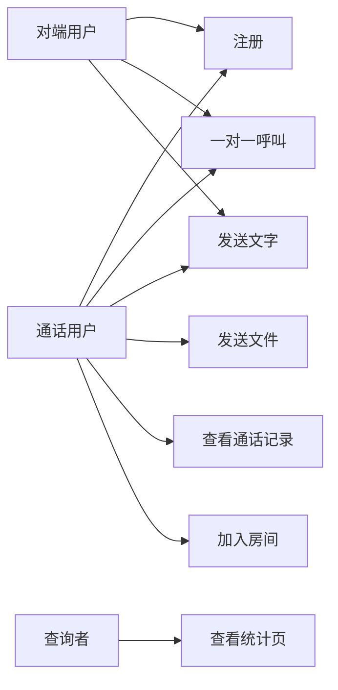

`加入房间` 与一对一呼叫都已可演示。向房间发文字不是用例，Kamailio 对 `room-*` 的 MESSAGE 回 405。

## 活动：发起一次视频呼叫

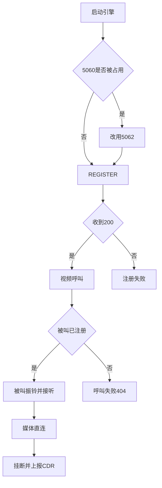

## 时序：注册

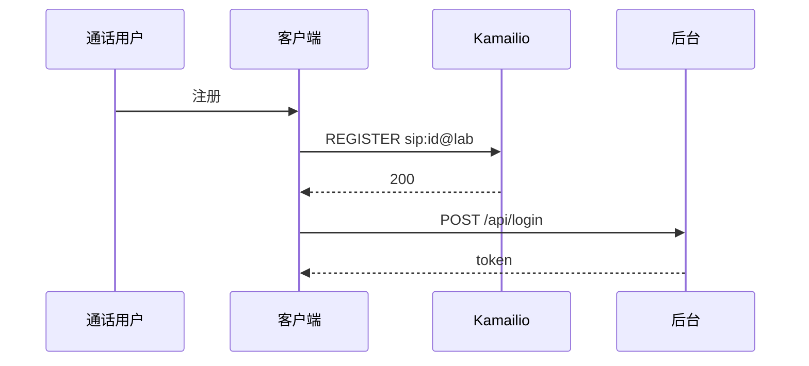

后台不可达时，SIP 注册仍然成功，界面保持未登录。

## 时序：一对一呼叫与挂断

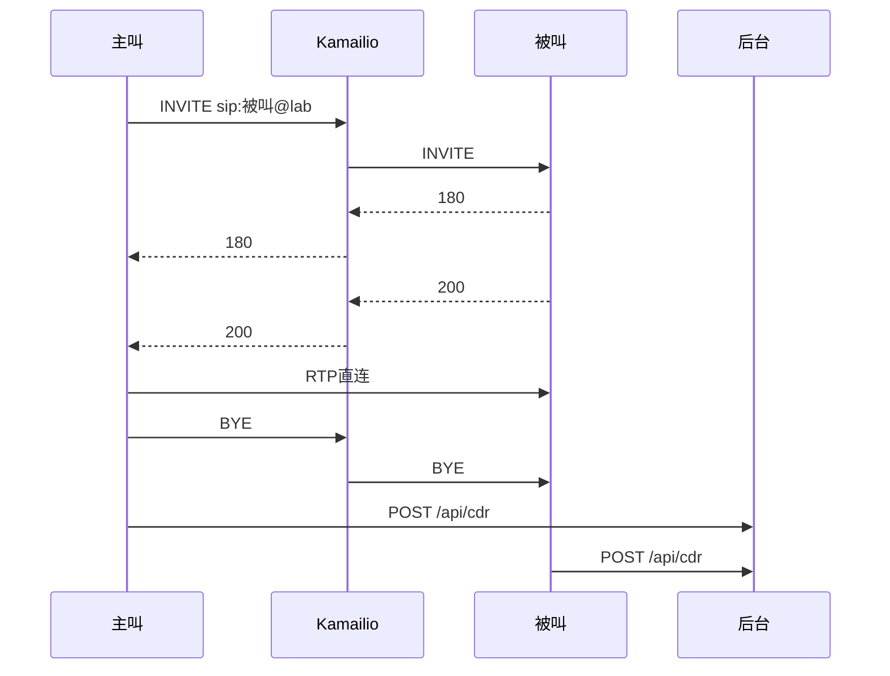

两条 CDR 用同一个 Call-ID 合并。视频 SDP 在 INVITE 和 200 里原样通过代理。

## 时序：文字未送达

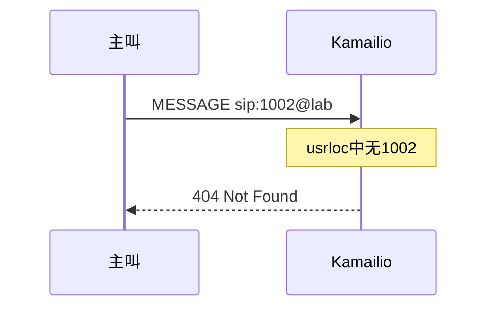

## 时序：文件

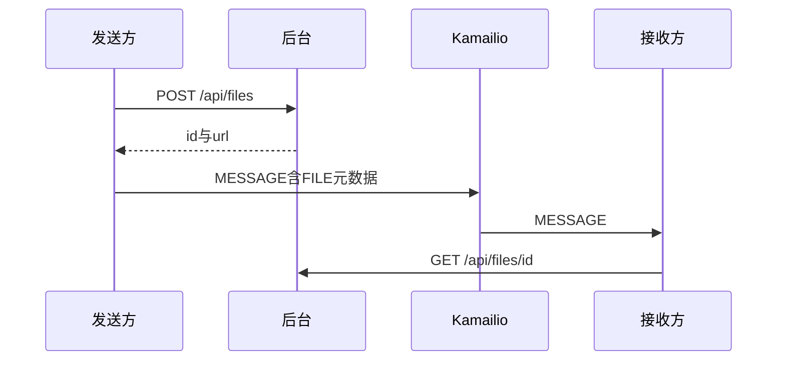

## 时序：加入房间

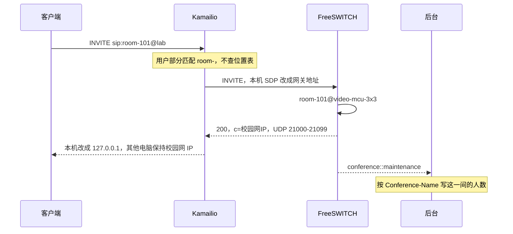

视频应答是 `97 H264/90000`，`profile-level-id=42e01e`，`packetization-mode=1`。同一条 `room-*` 前缀上的 MESSAGE 在 Kamailio 结束，响应是 `405 Room has no chat`，不会进 FreeSWITCH。一对一 INVITE 不走这条时序，SDP 也不改。满员时拨号计划仍可能先回 200，随后会议室结束这一路。

## 状态：一通呼叫

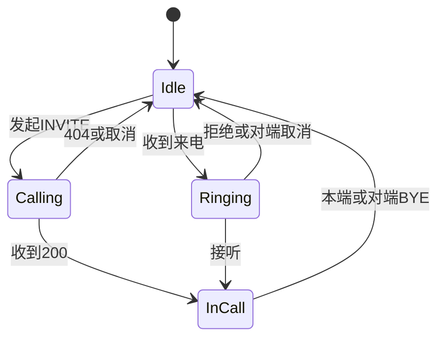

计时只在 `InCall`（CONFIRMED）期间累加。振铃失败的时长为 0。

## 状态：一条文字

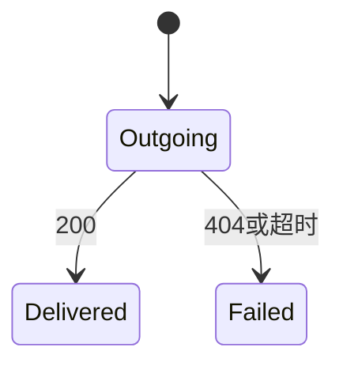

相同正文按发送顺序匹配回执，先发出的先确认。

## 类：业务里要记住的对象

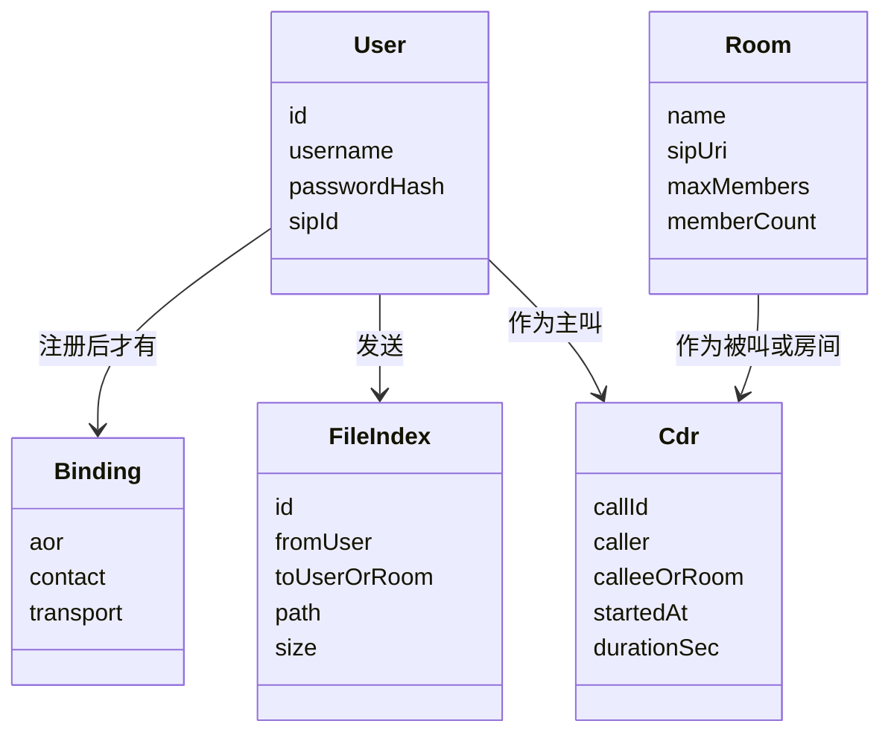

`User`、`FileIndex`、`Cdr`、`Room` 在 SQLite。`Binding` 只在 Kamailio 内存里，不写入业务库。`Room.memberCount` 由 ESL 按会议名写回，是这一间的当前人数。

## 组件

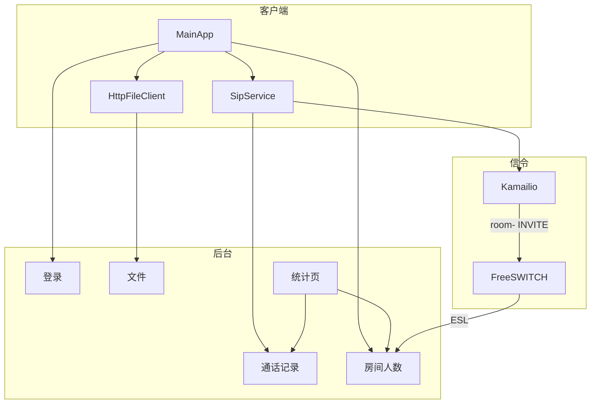

一对一媒体不经过 FreeSWITCH。统计页只读查询接口。

## 部署

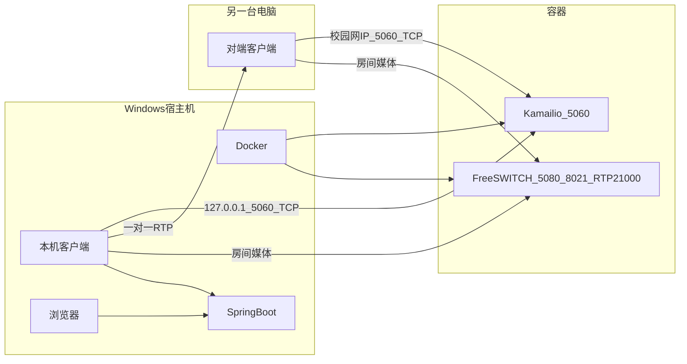

一对一媒体在两台客户端之间直连，不进容器。房间媒体进入 FreeSWITCH，每人拿回一路混流。本机与对端看到的 SIP 服务器地址不同，域都是 `lab`。

## 开发视图

三个开发角色对应三个目录，依赖方向只允许沿已公布的接口。

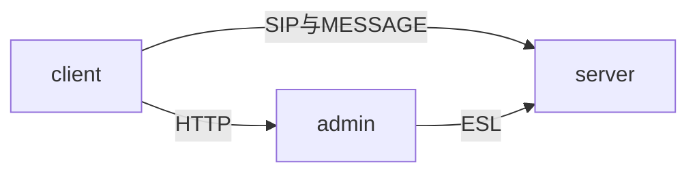

客户端不改 Kamailio 配置。后台不发 SIP。信令不写管理页面。
