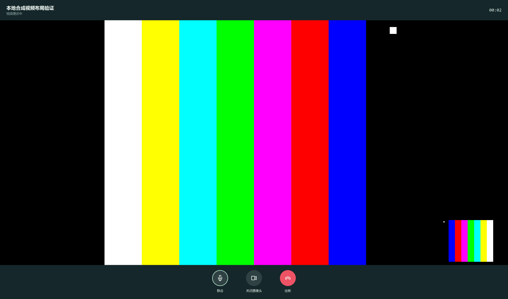
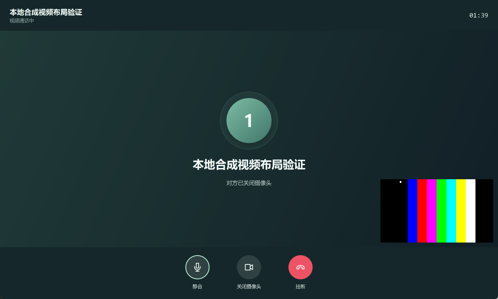

# 2026-11-04 远端对齐与本地优化续做

## 基线与提交组织

本地 main 已快进到远端 `9d99af9b2b2992b6f29d39ee988c0a45a742ea99`。保留 #55 的账号/退出登录改动、#56 的串行拨号/接听、#57 的原生 Call 保活和 SIP 回程修复。10 月 31 日未提交的 17 个布局文件已独立备份，旧工作区没有覆盖或删除。

审计发现 #51–#54 虽标记为 merged，但合入的是已合并过的功能分支，其修复不在 main 的祖先提交或等价代码中。本次重新整合，所有新 PR 均以 main 为目标：

| PR | 内容 | 依赖 |
|---|---|---|
| [#58](https://github.com/BUPTAL1S/software-practise/pull/58) | 身份与文件边界、消息分页、独立心跳、退出清理 | 独立 |
| [#59](https://github.com/BUPTAL1S/software-practise/pull/59) | 通话生命周期、摄像头同步、语音转视频、挂断竞态 | 独立 |
| [#60](https://github.com/BUPTAL1S/software-practise/pull/60) | SDL 尺寸、DPI、独立预览、镜像与原生布局验证 | 先合 #59，再合 #60 |
| [#61](https://github.com/BUPTAL1S/software-practise/pull/61) | MCU 1/2/4/9 格自适应配置 | 独立；未部署 |
| 本交付与报告 PR | 构建号、DLL 校验、诊断脚本及本文 | 新包需包含以上修复 |

本地整合分支 `client/resume-integration-20261104` 含上述改动；构建提交 `5d91dc8f8f3734149e791f40f9613ee298d3f917`，构建时 `dirty=false`。后续仅同步报告，不改变该包的应用逻辑。没有直接推送 main 或自动合并远端 PR。

## 用户选择的 A1–A5

| 项目 | 实际修改 | 本地验证与边界 |
|---|---|---|
| A1 稳定性 | UI 读缓存；媒体/预览串行执行；超时后保持忙状态，防止再次进入卡住的 JNI；销毁独立线程执行。新增挂断意图与媒体启动互斥 | 本轮真实复现了视频刚接通就挂断时 `sip-camera-state` 进入已释放媒体的原生崩溃，修复后呼入/呼出通过。不能据此断言已找到旧包“一分钟内卡死”的全部原因 |
| A2 布局与自视 | SDL 窗口恢复可调整大小；按 renderer 实际输出等比居中；PIP 为同级子窗口且独立于对端视频；统一 outputScale 和 Win32 像素坐标，检查真实附着结果 | 两路真实 SDL 窗口，最大化与连续缩放检查实际 HWND，而非仅检查 JavaFX 容器；远端关闭时 PIP 继续显示。多台显示器间跨 DPI 移动尚未验证 |
| A3 摄像头状态 | 期望/执行/实际状态分开；关闭自动视频发送；控制消息绑定对端与 Call-ID、序列号，定期重发，拒绝过期/其他通话消息；失败回退 | 会话/顺序/拒绝与 UI 响应回归通过；协议支持周期重同步，未实现单独 ACK 协议；未做双机对照 |
| A4 语音转视频 | 语音窗可开摄像头；re-INVITE 增加/改变视频方向；拒绝与超时回退；一端开启不自动开启另一端；保留通话 ID、音频会话与计时 | 本地模拟 SIP 对端接受/拒绝升级通过；真实另一台客户端与 MCU 的互通未验收 |
| A5 会议布局 | 客户端允许缩放并等比展示混流；MCU 改为 1/2/4/9 格布局组，保留既有 profile 名与 8 人上限 | 客户端原生窗口实测通过；MCU 仅 XML/引用/坐标/容量检查通过，没有启动或修改协作者 Docker |

SDL 根因已对照 [SDL 2.32.10 的 Windows 初始化源码](https://github.com/libsdl-org/SDL/blob/release-2.32.10/src/video/windows/SDL_windowswindow.c)：无边框窗口可能不带 `WS_THICKFRAME`，随后窗口初始化按 Win32 样式清掉 SDL 的 RESIZABLE 位。实际诊断记录创建请求 `0x34`、返回 `0x214`；补丁在 SDL 所属线程恢复请求的可缩放属性。绘制补丁每帧查询真实输出尺寸，等比居中，避免原始大小画面留在左上角。

窗口缩放事件和原生任务均合并，失败不会缓存成成功，挂断使旧请求失效。布局 ABI 2 使用新 JNI 名，两个历史入口保留原签名；Windows 镜像也检查 ABI 2，镜像仅作用本地 renderer。按照 PR 规范取消 Git 跟踪 `callwindow.dll`，源码运行需重建三个 DLL，便携包已包含。

截图复核另发现头像切换时子节点的旧可视边界扩大了视频定位范围，导致小窗压到控制栏；最终改用容器分配的 `layoutBounds`。回归按独立测量的实际视频区域检查 PIP 四边，覆盖远端有画面和关闭两种情况。





## 必要的 B 类改动

- B1/B7/B8：限制账号/SIP ID 和头像路径边界，头像解码前检查尺寸；密码不静默 trim；token 校验/续期与撤销原子化。
- B2/B5：私有文件鉴权和收发双方权限；客户端带认证取预览；流式 multipart、大小限制与临时落盘/失败清理，避免整文件复制到内存。
- B3/B4：增量消息按最早下一页读取；独立会议心跳线程、SIP 身份统一、连续缺失宽限；退出时停止心跳并取消附件预览任务。
- B6/B10 的必要部分：失败消息回执可重试，历史/增量查询下推数据库并限制读取数量。完整持久化发送队列、稳定消息 ID/幂等归档和所有列表分页没有全部实现。
- B9：修复本地镜像全局影响远端画面。
- B11/B13/B14：构建标识、DLL 指纹、实际 JNI 加载、manifest 核验、固定目录崩溃转储；修正异步 UI 验收的异常/等待行为；更新构建和 MCU 文档。

本轮未扩大到 B12 全自动质量自适应/设备选择、B15 跨角色 SIP 鉴权。现有 RTCP 数值与协商帧率仍不等于实测显示 FPS；未新增产品内实际渲染 FPS 采样，也不宣称测得端到端延迟改善值。

## 验证结果

| 验证 | 总数 | 通过 | 失败/错误 | 跳过 | 范围 |
|---|---:|---:|---:|---:|---|
| 后台完整 Maven | 109 | 108 | 0 | 1 | 独立测试数据库，真实 MCU 项跳过 |
| 客户端整合 Maven | 115 | 106 | 0 | 9 | 包含本机原生呼入/呼出及显式 SDL 布局测试 |
| 摄像头/媒体参数专项 | 2 | 2 | 0 | 0 | 真实摄像头界面开关 20 次；balanced/motion/legacy 与音频参数读回 |
| 持续原生渲染专项 | 1 | 1 | 0 | 0 | 最终原生库，持续 90 秒并完成 60 次缩放 |
| 管理网页 Edge | 11 | 11 | 0 | 0 | 随机端口假 HTTP，含父测试与 10 个子测试；未改生产页面 |
| MCU 配置静态校验 | 1 流程 | 通过 | 0 | 0 | XML、组引用、格子不越界/不重叠、容量和拨号 profile |
| Windows 便携包 | 1 流程 | 通过 | 0 | 0 | 清除开发 PATH，哈希/原生加载/后台健康/登录/API 读回 |

原生窗口最大化实际远端尺寸为 3840×1848，PIP 560×315；32 次连续缩放的最终尺寸为 1852×1116、PIP 463×260。测试等待几何尺寸真正收敛，而非排队即算成功。使用最终原生库的 90 秒持续渲染补充测试通过，完成 60 次缩放，JavaFX 调用持续返回；这不是网络通话或显示 FPS 基准。

主要复验命令（仓库根目录，Windows x64 JDK 17）：

```text
mvn -o -f admin/pom.xml test
mvn -o -f client/pom.xml -Dsip.nativeLayoutTest=true test
mvn -o -f client/pom.xml -Dtest=CameraPreviewLifecycleTest#cameraCanRestartOnUiThreadWithRemoteVideoStillEmbedded,NativeMediaPolicyTest -Dsip.nativeVideoTest=true -Dsip.nativePolicyTest=true test
mvn -o -f client/pom.xml -Dtest=NativeLayoutIntegrationTest -Dsip.nativeLayoutTest=true -Dsip.nativeLayoutSoakSeconds=90 test
```

浏览器回归先将 `CHROME_PATH` 指向本机 Edge/Chrome，再运行 `node --test admin/src/test/js/admin-workbench.test.cjs`。本机初次尝试因默认 Chrome 路径不存在而未启动，指定 Edge 后 11 项全通过。原生日志直接写 stdout 会产生 Surefire 通道警告，最终测试结果仍为 0 失败/错误；相关 dumpstream 保留在测试输出。

摄像头专项在独立进程中使用本机合成 SIP 对端，不发送远端真实视频；它验证窗口/预览切换与响应，不代表双机视听质量。完整测试跳过项和另行启用专项分开统计，不把专项通过重复计入完整套件。

日志：`resume-integration-admin.log`、`resume-final-client.log`、`resume-native-camera-policy.log`、`resume-integration-web.log`、`resume-native-reproducible.log`、`resume-final-soak.log`、`resume-final-package-build.log`、`resume-final-package-verify.log` 均保存在本机执行目录。便携包内 `validation-*/result.json` 记录健康、登录、8 用户、2 房间、0 话单、ESL 禁用；隔离后台进程已按句柄停止，没有使用正式数据库。

## 原生来源与交付

PJSIP 固定提交 `5a457451fa2712ba18e12b01738e8ff3af2b26fd`；正式脚本重建 x64 SDK/JNI，依次应用释放、延迟、视口三个补丁。依赖 SDL 2.32.10、Windows x64 JDK 17.0.20.1。

| 文件 | 字节 | SHA256 |
|---|---:|---|
| pjsua2.dll | 25419215 | `fb3c77d2adff777f812d2a1409072c7c7278ab043d54f6c5d1ecfdd3af7636b4` |
| callwindow.dll | 33673 | `c635deb9e4d382b333a354c0f8b66f0f9acca683c6db8f398009be0d03a8e70a` |
| winmirror.dll | 12800 | `0958d56769ecc253e3c02559a2f1417c74d80e9ba6bad3c28a19802ba99bbf58` |
| 客户端 ZIP | 63102775 | `a3773954a39b4c331f3d4b4837db40d1fae4637b97b7b7e2326a2d67cd378914` |
| 后台 ZIP | 97254900 | `37d0bc27c9e9593af58edb903d8973a9709a45bc71e29a93cf02f702c2521847` |

交付目录名 `windows-20261104-5d91dc8`。每包包含 `build-id.txt` 和 manifest；客户端启动日志显示 `5d91dc8f8f37`。`collect-diagnostics.bat` 生成不含账号偏好和 token 的 DLL 指纹报告；安装包混用检查与独立验证步骤见 [Windows 交付说明](../windows-delivery.md)。

## 未验证与后续边界

用户确认协作者电脑未开机，本轮只做本地测试。早先一次 8080 TCP 连接成功但 `/api/health` 超时，不能作为协作者服务器在线证据；收到说明后停止远端探测。没有修改路由、网卡、防火墙、协作者 Docker 或正式数据。

没有进行校园网两机通话、多人 MCU 入会、实测端到端延迟、跨显示器 DPI 移动或 macOS 编译。A5b 配置需要 MCU 负责人后续在维护窗口加载并使用新会议验收。旧包现场卡死仍需新版本日志/转储对照；本报告只声明上述已覆盖路径和本地结果。
