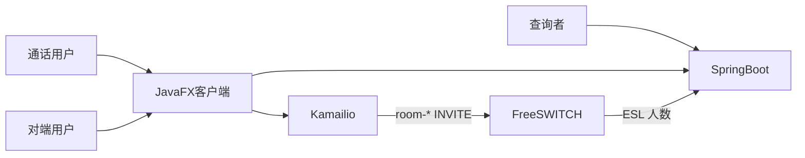

# 用户分析

分析对象是本仓库这套 Java PC 即时通信：SIP 一对一音视频、在线文字、HTTP 文件、后台统计，以及已经接入呼叫路径的房间 MCU。

方法：利益相关者分析、用户画像、场景和用户旅程。开发三角色（客户端、信令、后台）是建设者，不是通话用户。图见 [UML.md](UML.md)。

## 系统边界

系统内：JavaFX 客户端、Kamailio、FreeSWITCH、Spring Boot 与 SQLite。

系统外：校园网、Windows / macOS 的摄像头和声卡、浏览器（只看统计页和管理页）。一对一 RTP 在两个客户端之间直连，不进 Kamailio。房间视频由 FreeSWITCH 混成一路再发回每个客户端。

## 利益相关者

| 相关者 | 目标 | 关心什么 | 对需求的影响 |
|---|---|---|---|
| 通话用户 | 和另一台电脑通话、发文字和文件 | 能注册、能打通、能挂断、能看到画面 | 功能需求的主体 |
| 同机调试者 | 在跑着 Docker 的这台 Windows 上自测 | 本机填 `127.0.0.1`，不和 Kamailio 抢 5060 | 部署和网络约束 |
| 对端用户 | 从另一台电脑（常见是 Mac）连过来 | 填宿主机校园网 IP，域仍是 `lab` | 双机验收 |
| 查询者 | 在浏览器看通话次数和时长 | 统计页不用再装客户端 | 阶段 4 的管理查询 |
| 验收老师 | 按阶段看两台电脑和报告 | 选型不偏离课件，房间与一对一分开 | 范围和「不做」清单 |
| 客户端开发 | 一套 Java 跑 Win / Mac | SIP 与 HTTP 字段稳定 | 接口需求 |
| 信令开发 | 一套 Docker 上的 Kamailio / FreeSWITCH | 只转发约定的方法和 URI | 路由规则 |
| 后台开发 | 一个 Spring Boot 进程 | 不实现 SIP，不发呼叫命令 | 数据与 ESL 边界 |

影响力最高的是验收约束和双机网络。查询者不参与通话，不能把管理页做成通话入口。

## 用户角色

终端侧只有一种通话用户。差别来自他所在的机器，不是权限等级。

| 角色 | 是谁 | 能做的事 |
|---|---|---|
| 通话用户 | 演示或验收时操作 JavaFX 的人 | 注册、语音、视频、挂断、文字、发文件、加入 `room-*`、看自己的通话记录 |
| 同机用户 | 通话用户坐在 Kamailio 所在的 Windows 上 | 同上，但 SIP 服务器必须填 `127.0.0.1` |
| 对端用户 | 另一台电脑上的通话用户 | 同上，SIP 服务器填宿主机校园网 IP |
| 查询者 | 用浏览器打开 `http://localhost:8080/` 的人 | 看统计、CDR 和用户列表，不能发起呼叫 |

账号 `1001`–`1008` 是预置演示号，没有自助注册，也没有管理员账号体系。HTTP 密码与用户名相同；SIP 密码任意非空，两套密码不同步。

## 画像

**同机演示者。** 在自己的 Windows 上启动 Docker、后台和客户端。要尽快打通，不关心 FreeSWITCH 内部配置。失败时最常见的是把校园网 IP 填进「SIP 服务器」，或和 Kamailio 抢 `5060`。

**对端演示者。** 使用 Mac 或另一台 Windows。只拿到一个 IP、域 `lab`、一个账号。域若被改成 IP，身份会变成 `sip:1001@10.x`，和本域对不上。视频必须和对方同一套 H.264，否则协商失败后通话会断。

**查询者。** 验收时打开统计页和管理页，核对次数、总时长、平均时长和房间人数。不登录也能看统计。房间当前人数来自 ESL；峰值还会和通话记录的时间重叠比较，取更大的那个。

## 目标与痛点

| 目标 | 现在怎么满足 | 用户侧的痛点 |
|---|---|---|
| 找到对方并呼叫 | 注册后按 `sip:<用户>@lab` 呼叫 | 对方没注册时，文字是 404，呼叫是 404 |
| 听到声音、看到画面 | 一对一媒体直连 | 防火墙只放 5060 时信令通、画面黑 |
| 结束通话 | 挂断后对端收到 BYE | 早期版本 BYE 只到一侧 |
| 发文字 | 仅转发给在线用户 | 没有离线消息，未送达要看状态码 |
| 发图片和文件 | HTTP 存文件，SIP 只带一条元数据 | 后台没开时上传失败 |
| 回顾打过的电话 | 客户端看板和浏览器统计页 | 未接通时长为 0，容易当成没记下 |
| 多人进一个房间 | 呼叫 `sip:room-101@lab` 或 `room-102`，FreeSWITCH 合成 3×3 | 房间里发文字会 405；要私聊得把对端改回用户号。第 9 人进不去 |

## 场景

**场景 A，双机语音。** 宿主机用 `1001` 注册到 `127.0.0.1`，对端用 `1002` 注册到校园网 IP。一方呼叫，另一方接听，双方挂断后记录里有时长。主成功路径。

**场景 B，双机视频。** 与 A 相同，但两边都要有带 H.264 的原生库，SDP 使用载荷 97、`profile-level-id=42e01e`、`packetization-mode=1`。缺视频库时界面降成纯音频，这是降级，不是失败。

**场景 C，发文字失败。** 只有 `1001` 在线，向 `1002` 发「111」。Kamailio 查不到位置，回 404。界面显示发送未送达。这是规定行为，不是缺陷。

**场景 D，发文件。** 双方都在线，且后台在 `8080`。发送方上传文件，再用 MESSAGE 把 `[FILE] 名字 | 大小 | URL` 交给对方。对方下载或在窗口里看图片。

**场景 E，查统计。** 至少有一条已上报的通话。查询者打开统计页，看到次数和时长。不需要操作客户端。

**场景 F，进房间。** 两边都已注册。呼叫目标填 `room-101`（或界面里新建研讨室后返回的 `room-<id>`）。Kamailio 把这路 INVITE 送到 FreeSWITCH，不查用户位置表。每人看到的是同一路 1280×720 的 3×3 画面，编码与一对一相同：载荷 97、`profile-level-id=42e01e`、`packetization-mode=1`。其他电脑的媒体打到宿主机校园网 IP 的 UDP `21000-21099`。坐在 Docker 这台机器上的人，媒体打到 `127.0.0.1` 的同一段端口，避免头发夹。后台按这一间的入会、离会更新人数。第 9 人进不去。在房间里发 MESSAGE 会得到 `405 Room has no chat`；要和某个人发文字，把对端改回 `1002` 这类用户号。一对一呼叫不会被改送到会议室。

## 旅程

一次完整演示，按用户动作排列：

1. 启动引擎。本机端口若被 Kamailio 占用，从 5060 改到 5062。
2. 填写 SIP 服务器、域、账号，注册。后台若可达，客户端用同名密码静默登录。
3. 语音或视频呼叫。只让一方先打，另一方看到来电再接。
4. 需要多人时，呼叫 `room-101` 或 `room-102`。挂断即离开会议室。
5. 挂断。客户端把 Call-ID、主被叫、开始时间和时长交给后台。
6. 发文字或文件。文件先 HTTP，再 SIP 通知。文字发给用户，不发给房间。
7. 在客户端看板或浏览器统计页核对记录和房间人数。

失败时用户应能区分：未注册（404）、房间没有群聊（405）、会议室已满（第 9 人被拒绝）、后台不可用（登录或上传失败）、本机视频库缺失（纯音频模式）。

## 环境差异

| 环境 | 用户要遵守的规则 |
|---|---|
| Windows + Docker Desktop | SIP 服务器填 `127.0.0.1`，传输 TCP，域 `lab` |
| 另一台电脑 | SIP 服务器填宿主机校园网 IP，域仍是 `lab` |
| 换 Wi-Fi | 重新跑 `start-kamailio`，把新 IP 告诉对端。会议室地址跟着变 |
| 其他电脑进房间 | 宿主机防火墙放行 UDP `21000-21099`，不只放 `5060` |
| 两个窗口在同一台机器 | 账号不同，后一个窗口不要用 5060 |

这些差异来自部署，不做成两套客户端。
